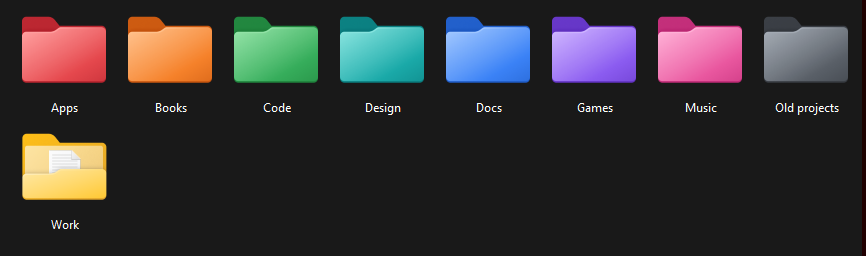
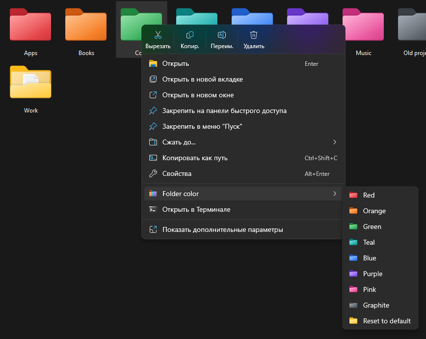

# Folder Colors for Windows 11

Color your folders from the right-click menu. Pick one of 8 colors, and the folder gets a
recolored version of the native Windows 11 folder icon. Nothing inside the folder changes.





- Lives in the **new Windows 11 context menu**, no "Show more options" needed.
- Works on several selected folders at once.
- **Reset to default** brings back the stock icon.
- Rename or move a colored folder and it stays colored; uninstall still finds it.
- On x64 and ARM64 PCs (Snapdragon, Surface Pro X and the like).
- No admin rights, no background process, nothing runs until you click the menu.
- `desktop.ini` stays out of git in every repository, with no `.gitignore` edits.

## Install

**Quick install**: open PowerShell and run

```powershell
irm https://raw.githubusercontent.com/FewchX/win11-folder-colors/main/get.ps1 | iex
```

It downloads the latest release, checks it against the SHA-256 that GitHub lists for the file
and runs its installer. [`get.ps1`](get.ps1) is 30 lines; read it first if you like.

**Or manually**: download `win11-folder-colors.zip` from the
[latest release](https://github.com/FewchX/win11-folder-colors/releases/latest), extract it and
double-click `install.cmd`. If Windows shows "Windows protected your PC", click
**More info → Run anyway**: the scripts aren't signed. The release page shows the file's
SHA-256 next to it.

The source code (**Code → Download ZIP** or `git clone`) installs the same way with
`install.cmd`. It has no prebuilt files, so the installer downloads the one it needs,
`FolderColorMenu.dll`, from the release of the same version and checks its SHA-256.

Installing again (a newer version, or after editing the colors) keeps every folder's color.

### Developer Mode

The new Windows 11 menu only shows entries from installed app packages. Folder Colors
registers a small local package for that, and Windows accepts an unsigned local package only
with **Developer Mode** on:

**Settings → System → For developers → Developer Mode**

If it's off, the installer opens that page and waits for you. If you'd rather not turn it on,
type `C` there: you get the same menu under **Show more options** instead. The installer never
changes this setting itself.

Requirements: Windows 11 on an x64 or ARM64 PC (Windows 10 works too, with the classic menu).
Everything else the installer needs is part of Windows.

## Use

Right-click a folder (or several) → **Folder color** → pick a color. The new icon shows up
within a second or two. An open window with large icons first shows the plain folder for a
moment, then the color.

## Uninstall

**Settings → Apps → Installed apps → Folder Colors → Uninstall**, or run `uninstall.cmd` from
the zip. Every folder you colored is reset to the stock icon first, also ones you renamed or
moved since (on the same drive). To remove the menu and keep the colors, run
`uninstall.ps1 -KeepColors`: only the icons stay behind. To reset those folders later, install
again and uninstall normally.

## Is it safe for my files?

Yes. Folder Colors uses the same mechanism as **Properties → Customize → Change Icon**
in File Explorer, which Windows itself uses for Documents, Downloads and other special folders:

1. A hidden `desktop.ini` file in the folder, with one `IconResource=` line pointing to the icon.
2. The folder's **read-only** attribute. On folders this doesn't make anything read-only; it only
   tells File Explorer to read `desktop.ini`.

Files and subfolders inside are never read, moved or modified, and you can keep working in
the folder as usual. If the folder already had a `desktop.ini` (Documents, Downloads and other
special folders do), everything else in it is kept, and **Reset to default** brings back the
folder's own icon. Reset only ever undoes a color set by Folder Colors: on a folder with an
icon of its own (Desktop, a OneDrive folder, one customized in Properties) it changes nothing.

Folder Colors also refuses to touch a `desktop.ini` that is a link to another file, as one
from a downloaded archive or repository could be, so its writes can't land anywhere else.
`desktop.ini` refers to the icons as `%LOCALAPPDATA%\...`, so it doesn't contain your user name
when the folder is synced or shared.

### And git?

`desktop.ini` never ends up in your repositories, and you don't need to add it to any
`.gitignore`. The installer adds it once to git's global ignore file, which every repository on
your PC reads. That includes repositories you create later in a folder that's already colored.
The file is `~/.config/git/ignore`, or the file set in `core.excludesFile` if you have one.
GitHub's standard Windows `.gitignore` template ignores `desktop.ini` the same way. The line is
added even if git isn't installed yet, so it's in place once you install it. Uninstall removes
it again. To skip this, install with `install.ps1 -NoGitIgnore`. Nothing inside your
repositories, `.git` included, is ever touched.

Version 1.0 also added the line to each repository's `.git/info/exclude`. Installing 1.1 or
later removes those lines again, since the global ignore file covers them.

Why not keep `desktop.ini` somewhere else? File Explorer reads a folder's custom icon only from
the `desktop.ini` inside that folder. There's no setting to point it elsewhere.

Things worth knowing:

- **Scripts that delete the folder itself.** Some programs refuse to delete a read-only folder:
  .NET's `Directory.Delete` and Python's `shutil.rmtree` delete everything inside but fail on the
  folder itself with "Access denied". File Explorer, `rd /s` and `Remove-Item -Force` work
  normally. Don't color folders that tools delete and recreate, like `build` or `dist`, or reset
  the color first.
- **Cloud folders.** In OneDrive or Dropbox, `desktop.ini` syncs too. On a computer without
  Folder Colors the folder just looks like a normal folder.
- **Where the icons live.** Colored folders point to the icons in
  `%LOCALAPPDATA%\Programs\FolderColors\icons`. Uninstall resets the folders before it deletes
  the icons. A synced folder shows its color on every PC that has Folder Colors installed.
- **Moved folders.** Folder Colors recognizes a folder by its file system ID, which stays the
  same when the folder is renamed or moved on the same drive (NTFS or ReFS). A folder moved to
  another drive is a copy there: it keeps its color, but uninstall can't find it. Reset it from
  the menu before you uninstall, or color it again to have it tracked.

## Change the colors

Edit [`colors.json`](colors.json) and run the installer again. Each color has an `id` (icon
file name), a `label` (menu text) and a `ramp` of three colors: the darkest edge, the main
color and the highlight. Folders you already colored use the same icon files, but File
Explorer may keep showing the old shade until it refreshes its icon cache.

## How it works

| Part | What it does |
|---|---|
| `src/FolderColor.cs` | `FolderColor.exe`: writes `desktop.ini`, sets the attribute, tells Explorer to refresh. Runs one at a time, so quick clicks can't mix up their edits. Keeps the list of colored folders, by path and file system ID. Also builds the icons. |
| `src/IconBuilder.cs` | Recolors the stock folder icon (`imageres.dll`) at every size with a gradient map that keeps the native shading. |
| `src/FolderColorMenu.cpp` | `FolderColorMenu.dll`: the `IExplorerCommand` handler behind the menu. It only builds the menu (shown for folders on disk only) and starts `FolderColor.exe`. |
| `package/AppxManifest.xml` | The local package that gives the DLL the identity the Windows 11 menu requires. |
| `install.ps1` / `uninstall.ps1` | Install into `%LOCALAPPDATA%\Programs\FolderColors` for the current user. The installer builds everything before it replaces the previous version. |
| `tests/run-tests.ps1` | `FolderColor.exe` end to end on throwaway folders: coloring, reset, odd paths, links, moved folders, parallel runs. |
| `tests/run-menu-tests.ps1` | The menu DLL, driven by `tests/menu-harness.cpp` the way File Explorer does: where the menu shows, what it shows, and that its items work, also for 300 folders at once. |
| `tests/run-install-tests.ps1` | A real install, use through the package and uninstall, also with `-Classic` and `-KeepColors`. CI only. |

CI runs all three on x64 and on ARM64 Windows for every push, on fresh virtual machines.

The repository contains no Microsoft artwork. The installer builds the icons on your PC from
your own Windows folder icon, so they always match your Windows version. `FolderColor.exe` is
compiled during install with the C# compiler that ships with Windows (.NET Framework 4).
Only `FolderColorMenu.dll` comes prebuilt in the release zip, one for x64 and one for ARM64,
built by [GitHub Actions](.github/workflows/release.yml) from the source in this repository,
with the actions pinned to exact commits and the compiler to exact file hashes.

## Build from source

Only `FolderColorMenu.dll` needs a C++ compiler. When it's missing, `install.ps1` builds it
if Python with the [ziglang](https://pypi.org/project/ziglang/) package is available (a
complete C++ toolchain, no Visual Studio needed, that builds for x64 and ARM64 on either),
and otherwise downloads it from the release:

```powershell
git clone https://github.com/FewchX/win11-folder-colors
cd win11-folder-colors
python -m pip install --require-hashes -r requirements-build.txt   # optional: the compiler
.\build.ps1 -Tests             # optional: bin\x64 and bin\arm64\FolderColorMenu.dll, test harness
.\tests\run-tests.ps1          # optional: tests on throwaway folders
.\tests\run-menu-tests.ps1     # optional: tests the menu DLL (needs build.ps1 -Tests)
.\install.ps1
```

Pushing a `v*` tag that matches the version in `package/AppxManifest.xml` builds the release
zip, runs the tests and publishes it on GitHub.

## Troubleshooting

- **The menu entry is missing.** Check that Developer Mode is on and run the installer again.
  Without Developer Mode, the entry is under **Show more options**.
- **The color doesn't show.** Press F5 in that window. Thumbnail views sometimes hold on to the
  old picture for a moment.
- **"Running scripts is disabled on this system".** Use `install.cmd`, or run
  `powershell -ExecutionPolicy Bypass -File install.ps1`.
- **"A whole drive can't be colored".** A drive's icon doesn't come from `desktop.ini`; color the
  folders on it instead.
- **Very long paths.** Folders with a path longer than about 250 characters can't be colored;
  you get an error message instead.

## License

[MIT](LICENSE)
